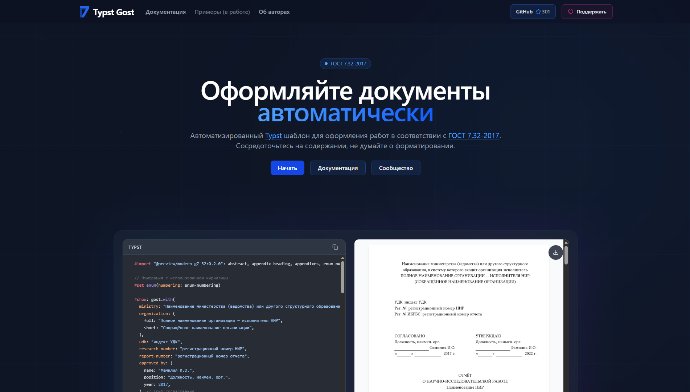

# Typst Gost Website

<a href="https://github.com/typst-gost/website/blob/main/LICENSE"></a>
<a href="https://github.com/typst-gost/website/actions"></a>
<a href="https://typst-gost.ru"></a>

Официальный сайт проекта Typst Gost - экосистемы шаблонов для оформления документов в соответствии с ГОСТ.



Проект создан на базе [Next.js](https://nextjs.org) с использованием [Fumadocs](https://fumadocs.dev/) для генерации документации, встроенного WASM-компилятора Typst, AI-ассистента и панели управления (`/admin`).

## Быстрый старт

### Установка Bun

Проект использует [Bun](https://bun.sh) как пакетный менеджер и runtime. Установите Bun одним из способов:

#### Linux/macOS
```bash
curl -fsSL https://bun.sh/install | bash
```

#### Windows (PowerShell)
```powershell
irm bun.sh/install.ps1 | iex
```

#### Через npm
```bash
npm install -g bun
```

### Запуск проекта

1. **Клонируйте репозиторий:**
   ```bash
   git clone https://github.com/typst-gost/website.git
   cd website
   ```

2. **Установите зависимости:**
   ```bash
   bun install
   ```

3. **Настройте переменные окружения (при необходимости):**
   ```env
   AI_GATEWAY_URL=http://127.0.0.1:8085  # адрес ai-gateway для чата и /admin (в Docker: http://ai-gateway:8085)
   HOSTNAME=0.0.0.0                      # обязательно для Next.js standalone в Docker с несколькими сетями
   TELEGRAM_BOT_TOKEN=                   # опционально: счётчик участников в /api/telegram-members
   FEEDBACK_GITHUB_APP_ID=               # опционально: отправка отзывов о документации в GitHub Discussions
   FEEDBACK_GITHUB_APP_PRIVATE_KEY=
   ```

4. **Запустите сервер разработки:**
   ```bash
   bun run dev
   ```

5. Откройте [http://localhost:3000](http://localhost:3000) в браузере

### Доступные команды

```bash
bun run dev          # Запуск сервера разработки
bun run build        # Сборка проекта для продакшена
bun run start        # Запуск production сервера
bun run lint         # Проверка кода линтером
```

## Возможности

- **Интерактивная документация (`/docs`)**: примеры с живым редактированием и компиляцией Typst прямо в браузере, hover-цитаты ГОСТ 7.32-2017, полнотекстовый поиск и экспорт для LLM (`/llms.txt`, `/llms-full.txt`).
- **AI-ассистент**: чат по документации в реальном времени (SSE через `ai-gateway`) с учётом текущей страницы и ссылками на источники.
- **Панель управления (`/admin`)**: аналитика и логи диалогов, управление профилями/моделями и промптами, переиндексация базы знаний, тестирование TopicGuard и оценка метрик RAG (`Recall@k`, `HitRate@k`, `MRR`, подстановка датасетов и разбор промахов).

## Технологии

- **[Next.js](https://nextjs.org)** - React фреймворк для веб-приложений
- **[Fumadocs](https://fumadocs.dev/)** - движок документации и поиска на базе Next.js
- **[typst.ts](https://github.com/Myriad-Dreamin/typst.ts)** - компиляция и рендеринг Typst в браузере через WebAssembly
- **[Vercel AI SDK](https://ai-sdk.dev/)** - стриминг ответов AI-ассистента (в связке с `ai-gateway`)
- **[Tailwind CSS](https://tailwindcss.com)** - CSS фреймворк
- **[TypeScript](https://www.typescriptlang.org)** - типизированный JavaScript
- **[Bun](https://bun.sh)** - быстрый пакетный менеджер и runtime

## Документация

- **[Next.js документация](https://nextjs.org/docs)**
- **[Fumadocs документация](https://fumadocs.dev/docs)**
- **[Tailwind CSS документация](https://tailwindcss.com/docs)**
- **[Bun документация](https://bun.sh/docs)**

## Обновление версии Typst

При выходе новой версии Typst необходимо обновить версию в трёх местах:
1. **WASM файлы компилятора и рендерера:**
```text
public/wasm/typst_ts_renderer_bg.wasm
public/wasm/typst_ts_web_compiler_bg.wasm
```
Заменить файлы для использования новой версии

2. **Константа версии для кэша WASM в `src/hooks/use-typst-compiler.ts`:**
```ts
const TYPST_VERSION = "0.7.0-rc2";
```

3. **Зависимости в** `package.json`:
```json
{
   "dependencies": {
      "@myriaddreamin/typst-ts-node-compiler": "^0.7.0-rc2",
      "@myriaddreamin/typst.ts": "^0.7.0-rc2"
   }
}
```

4. **Установите обновленные зависимости:**
```bash
bun install
```

## Лицензия

Проект распространяется под лицензией GPL-3.0. См. файл [LICENSE](LICENSE) для подробностей.

## Связь

- **Сайт:** [typst-gost.ru](https://typst-gost.ru)
- **Telegram:** [@typst_gost](https://t.me/typst_gost)
- **Репозиторий:** [github.com/typst-gost/website](https://github.com/typst-gost/website)
- **Issues:** [github.com/typst-gost/website/issues](https://github.com/typst-gost/website/issues)